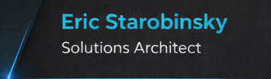

  

# Hi, I'm Eric 👋

**AWS | Cloud Engineering | Infrastructure**
20+ years building practical, scalable, hybrid cloud solutions.

I'm the founder of **[Digital Culture IT Solutions](https://digitalcultureit.com)**, an IT consulting firm.

🏅 [AWS Certified Solutions Architect – Associate](https://www.credly.com/badges/d6cf74ac-b8e8-4552-b395-e62c33520891/linked_in?t=tbw3d1)
🌐 [digitalcultureit.com](https://digitalcultureit.com)

---

## What I work with

---

## Featured projects

| Project | What it is |
|---|---|
| [s3-browser](https://github.com/estarobi50/s3-browser) | Private web UI for an S3 bucket using the Amplify UI Storage Browser, Cognito sign-in and a scoped IAM role |
| [jeanie-ai-denim-fit-finder](https://github.com/estarobi50/jeanie-ai-denim-fit-finder) 🔒 | AI-powered body-shape and denim fit analyzer on AWS serverless infrastructure |
| [digitalculture-design-projects](https://github.com/estarobi50/digitalculture-design-projects) | Showcase of web design projects |
| [digitalculture-site](https://github.com/estarobi50/digitalculture-site) | The Digital Culture IT Solutions website |
| [anchorage-management](https://github.com/estarobi50/anchorage-management) 🔒 | Custom WordPress website for Anchorage Management LLC on GoDaddy, with inquiry-form email delivery through Proofpoint and Microsoft 365 (private client repo, available upon request) |
| [betson-used-inventory-manager](https://github.com/estarobi50/betson-used-inventory-manager) 🔒 | Excel and VBA solution that keeps warehouse notes attached to the right used-game record when an inventory report refreshes (private client repo, available upon request) |

> 🔒 Some client projects are kept in private repositories to protect client privacy. I'm happy to walk through them upon request.

---

## Real-world projects

Real-world cloud and infrastructure solutions I've built, each documented step by step. Browse everything on my [repositories page](https://github.com/estarobi50?tab=repositories).

**Networking and compute**
- [AWS-Custom-VPC-Build](https://github.com/estarobi50/AWS-Custom-VPC-Build): custom VPC with internet gateway, subnets and route tables
- [AWS-Custom-VPC-EFS-Infrastructure-Lab](https://github.com/estarobi50/AWS-Custom-VPC-EFS-Infrastructure-Lab): VPC, EC2, Systems Manager and shared EFS storage
- [EC2-SSM](https://github.com/estarobi50/EC2-SSM): private EC2 instance reachable through Systems Manager
- [Create-AWS-account-for-production-](https://github.com/estarobi50/Create-AWS-account-for-production-): building out a new production AWS account

**Load balancing and scaling**
- [Setting-up-an-application-load-balancer-ALB-](https://github.com/estarobi50/Setting-up-an-application-load-balancer-ALB-): Application Load Balancer deployment
- [AWS-Auto-Scaling-Group-Application-Load-Balancer-ALB-](https://github.com/estarobi50/AWS-Auto-Scaling-Group-Application-Load-Balancer-ALB-): Auto Scaling Group and ALB with a golden AMI

**Web hosting and DNS**
- [secure-s3-cloudfront-site](https://github.com/estarobi50/secure-s3-cloudfront-site): static site on S3 behind CloudFront
- [setup-www-CNAME-and-new-ACM-cert](https://github.com/estarobi50/setup-www-CNAME-and-new-ACM-cert): www CNAME and a new ACM certificate

**VMware Cloud on AWS**
- [Deploying-vmware-sddc-to-aws](https://github.com/estarobi50/Deploying-vmware-sddc-to-aws): two-SDDC VMware Cloud on AWS deployment
- [fsx-ontap-nfs-datastore-vmware-cloud](https://github.com/estarobi50/fsx-ontap-nfs-datastore-vmware-cloud): Amazon FSx for NetApp ONTAP NFS volume as a supplemental datastore

---

## Get in touch

📧 [DigitalCultureits@gmail.com](mailto:DigitalCultureits@gmail.com)
🌐 [digitalcultureit.com](https://digitalcultureit.com)
